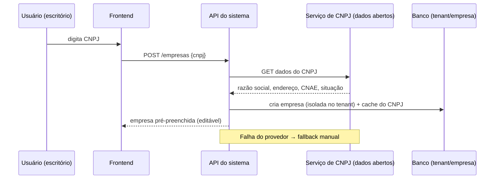
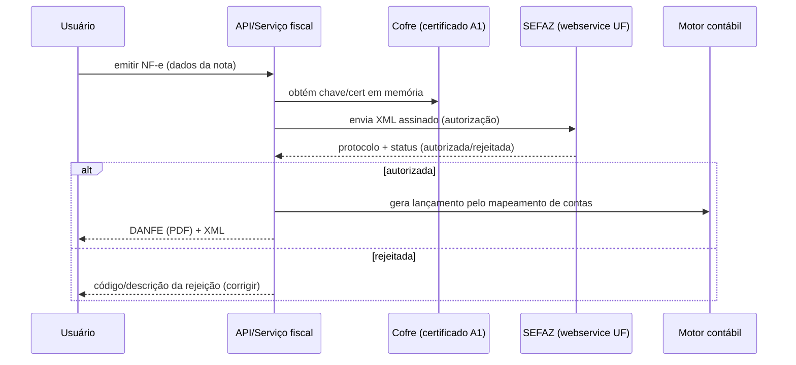
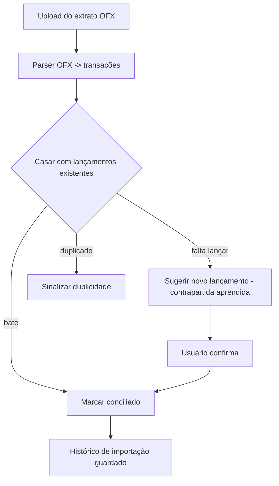
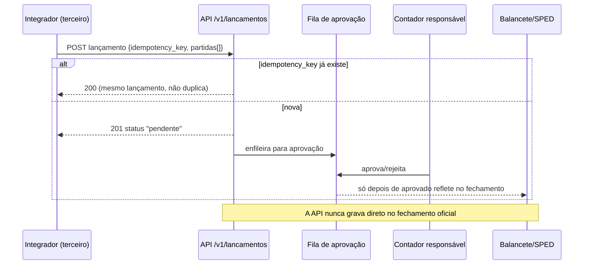
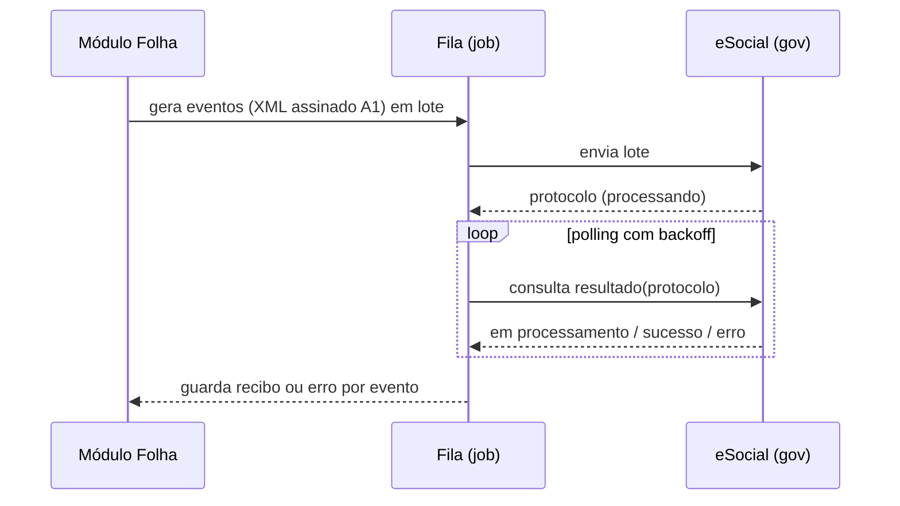

# Mapa funcional e fluxos (Fases 1 e 3)

Fonte: material público (llms.txt, Central de Ajuda, API, planos). **[COMPROVADO]** salvo marcação.

## Módulos da categoria (o que um ERP contábil precisa ter)

- **Cadastros/Estrutura:** Empresas (busca por CNPJ), Plano de Contas (sintéticas × analíticas), Centros de Custo (grupos/subgrupos, rateio), Categorias financeiras, Históricos padronizados.
- **Contábil:** Lançamentos (partidas dobradas, recorrentes, importação em lote, trilha de auditoria, aprovação), Conciliação (OFX/CNAB), Fechamento de período (bloqueio, checklist, reabertura rastreada, encerramento de exercício), Relatórios (Razão, Diário, Balancete, DRE, Balanço, DFC).
- **Fiscal:** Apuração (Simples/Presumido/Real, Fator R), guias (DAS/PGDAS-D com memória), SPED (ECD, ECF, EFD ICMS/IPI, Contribuições, Reinf), Agenda Tributária consolidada, NF-e/NFS-e/CT-e.
- **Folha:** Funcionários, cálculo mensal (INSS/IRRF/FGTS), férias, 13º, rescisão, eSocial, holerites, simulador de custo, provisões → contabilização.
- **Financeiro:** Contas a pagar/receber, Fluxo de caixa, retorno CNAB, aprovação de pagamentos.
- **Escritório:** Central de Obrigações (calendário oficial por empresa), tarefas (responsável/prazo), visão da carteira, histórico.
- **Portal do Cliente:** marca branca (nome/logo/cor do escritório), PWA; cliente baixa guias/documentos, envia arquivos, responde pedidos.
- **Transversais:** multiempresa com isolamento (LGPD), busca global, avisos proativos ("percebeu"), auditoria (quem/quando/o quê), permissões por papel.

## Jornada do usuário (onboarding) — [COMPROVADO/INFERIDO]

1. Marketing → **Testar grátis** (7 dias, sem cartão) ou **Entrar** (e-mail/senha ou Google).
2. Cria o **tenant** (escritório) e o primeiro usuário.
3. Cadastra a **primeira empresa** pelo **CNPJ** (preenche sozinho).
4. Define **regime tributário** e sobe o **certificado A1**.
5. Monta/importa o **plano de contas** (sugerido, CSV/Excel ou do zero).
6. Importa dados (planilhas, XML de notas, OFX) e informa **saldos de abertura**.
7. Usa os módulos; convida a equipe (papéis); ativa o **Portal do Cliente**.

---

## Diagramas dos fluxos-chave (Mermaid)

### A) Cadastro de empresa por CNPJ

### B) Emissão de NF-e (SEFAZ) com lançamento automático

### C) Conciliação bancária por OFX

### D) Lançamento via API: idempotência + fila de aprovação — [COMPROVADO]

### E) eSocial (transmissão assíncrona)

